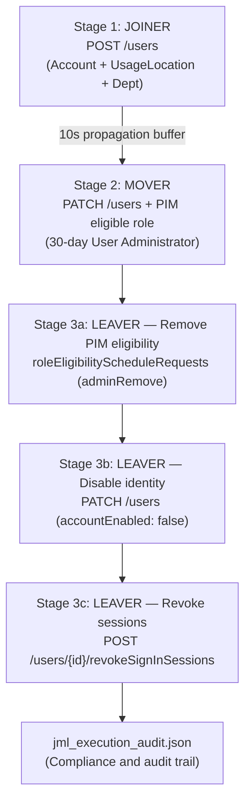

# Automated Joiner-Mover-Leaver (JML) & PIM Lifecycle Engine

Automates joiner, mover, and leaver workflows in Microsoft Entra ID, including Privileged Identity Management (PIM) role eligibility and offboarding audit events.

**Stack:** Python 3.14 · Microsoft Graph REST API v1.0 · Microsoft Entra ID P2 (PIM) · OAuth 2.0 client credentials

## 1. Overview

Manual onboarding and offboarding can lead to privilege creep during department transfers and orphaned sessions or directory roles after termination. This project demonstrates an automated lifecycle that provisions a user, updates their department and eligible role, then removes eligibility, disables the account, and revokes sessions.

## 2. Lifecycle sequence



### Engineering considerations

- **Cross-service replication:** Newly created users may not immediately be available to the PIM service. The engine uses a propagation buffer and bounded retry handling.
- **Offboarding order:** PIM eligibility is removed before the account is disabled, then active sessions are revoked. This sequence is intended to avoid disabling an account while it retains a directory role.

## 3. Example execution

The following is an example of a completed lifecycle run:

```text
[1/3] JOINER: Provisioning a user...
    [~] Waiting for Entra ID object propagation...
[2/3] MOVER: Updating the user's department and assigning an eligible PIM role...
[3/3] LEAVER: Removing PIM eligibility, disabling the account, and revoking sessions...
[+] JML lifecycle simulation complete. Audit events saved to jml_execution_audit.json
```

The generated `jml_execution_audit.json` contains execution timestamps, user identifiers, and lifecycle actions. Review and sanitize it before sharing or committing.

## 4. Required Microsoft Graph application permissions

| API | Permission | Type | Purpose |
| --- | --- | --- | --- |
| Microsoft Graph | `User.ReadWrite.All` | Application | Provision users, update attributes, disable accounts, and revoke sessions |
| Microsoft Graph | `GroupMember.ReadWrite.All` | Application | Manage department group memberships |
| Microsoft Graph | `RoleEligibilitySchedule.ReadWrite.Directory` | Application | Provision and revoke eligible directory role assignments |

Grant admin consent for the permissions configured for your tenant. Use least privilege and validate the workflow in a test tenant before production use.

## 5. Setup and usage

```bash
git clone https://github.com/numaan7/JML-Lifecycle-Engine.git
cd JML-Lifecycle-Engine
pip install -r requirements.txt
```

Create a local `.env` file with your app registration values. Do not commit this file:

```dotenv
TENANT_ID=<your-tenant-id>
CLIENT_ID=<jml-automation-app-client-id>
CLIENT_SECRET=<jml-automation-app-client-secret>
```

Run the pipeline:

```bash
python3 jml_lifecycle_engine.py
```

## 6. Ready-to-run Git commands for Codespaces

Run these commands from `/workspaces/JML-Lifecycle-Engine` to create the dependency file and ignore local environment and Python cache files:

```bash
cd /workspaces/JML-Lifecycle-Engine

cat <<'EOF' > requirements.txt
requests>=2.31.0
python-dotenv>=1.0.0
EOF

cat <<'EOF' > .gitignore
.env
__pycache__/
*.pyc
EOF

git status --short
git check-ignore -v .env
```

Verify that `.env` is ignored before staging. `git check-ignore` should report the `.gitignore` rule; if `.env` is already tracked, adding it to `.gitignore` will not untrack it. Also review the audit file for tenant or identity data and only stage it if it is appropriate to publish.

After reviewing the staged changes, commit and push:

```bash
git add README.md jml_lifecycle_engine.py jml_execution_audit.json requirements.txt .gitignore
git diff --cached
git commit -m "Add automated Entra ID JML and P2 PIM lifecycle engine with live audit telemetry"
git push
```
